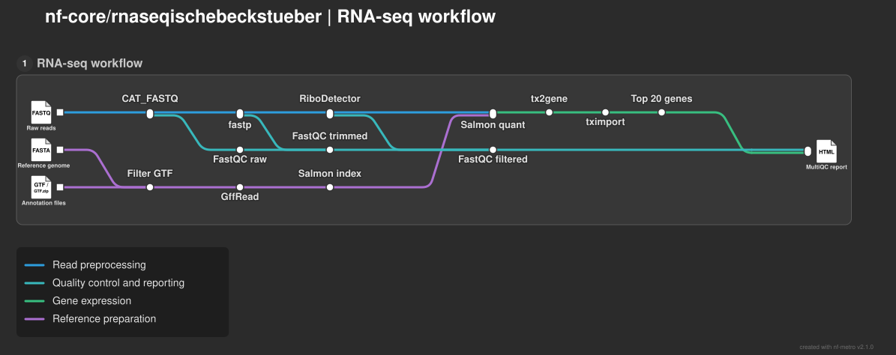

<h1>
  <picture>
    <source media="(prefers-color-scheme: dark)" srcset="docs/images/nf-core-rnaseqischebeckstueber_logo_dark.png">
    
  </picture>
</h1>

[](https://github.com/CleoStueber/computational-workflows-2026-week2-ischebeck-stueber/actions/workflows/nf-test.yml)
[](https://github.com/CleoStueber/computational-workflows-2026-week2-ischebeck-stueber/actions/workflows/linting.yml)
[](https://www.nf-test.com)
[](https://www.nextflow.io/)
[](https://github.com/nf-core/tools/releases/tag/4.1.0)
[](https://docs.conda.io/en/latest/)
[](https://www.docker.com/)
[](https://sylabs.io/docs/)

## Introduction

**rnaseqischebeckstueber** is a Nextflow RNA-seq pipeline built using the nf-core template and modules. It processes single-end and paired-end FASTQ reads, performs quality control and trimming, optionally removes rRNA reads, and quantifies transcripts with Salmon. It produces gene- and transcript-level expression matrices and a MultiQC report. Differential expression analysis is not included.



Diagram generated with `nf-metro` ([source](metro_horizontal.mmd)).

The main pipeline steps are:

1. Merge sequencing runs belonging to the same sample (`CAT_FASTQ`).
2. Check raw reads with [FastQC](https://www.bioinformatics.babraham.ac.uk/projects/fastqc/).
3. Trim reads with [fastp](https://github.com/OpenGene/fastp) and run FastQC again.
4. Optionally remove rRNA reads with [RiboDetector](https://github.com/hzi-bifo/RiboDetector) and check the filtered reads with FastQC (`--skip_ribodetector` to skip).
5. Filter the GTF annotation, extract transcripts with [Gffread](https://github.com/gpertea/gffread), and build a Salmon index.
6. Quantify transcripts with [Salmon](https://salmon.readthedocs.io/) and generate gene- and transcript-level matrices with [tximport/tximeta](https://bioconductor.org/packages/tximeta/).
7. Combine QC metrics, software versions, and the top 20 genes by mean TPM in [MultiQC](https://multiqc.info/).

## Usage

> [!NOTE]
> If you are new to Nextflow and nf-core, please refer to [this page](https://nf-co.re/docs/get_started/environment_setup/overview) on how to set up Nextflow. Make sure to [test your setup](https://nf-co.re/docs/get_started/run-your-first-pipeline) with `-profile test` before running the workflow on actual data.

First, prepare a CSV samplesheet with your FASTQ files:

`samplesheet.csv`:

```csv
sample,fastq_1,fastq_2,strandedness
sample1,data/sample1_R1.fastq.gz,data/sample1_R2.fastq.gz,auto
sample2,data/sample2.fastq.gz,,auto
```

Each row represents a single-end FASTQ file or a paired-end FASTQ pair. The `sample` and `fastq_1` columns are required; `fastq_2` and `strandedness` are optional. Repeated sample IDs are merged. Strandedness may be `forward`, `reverse`, `unstranded`, or `auto` (automatic detection by Salmon).

Now, you can run the pipeline from the repository root using:

```bash
nextflow run . \
    -profile docker \
    --input samplesheet.csv \
    --fasta reference.fa \
    --gtf annotation.gtf \
    --outdir results
```

Replace the example paths with your FASTQ files and matching reference FASTA and GTF annotation. To run the small test dataset:

```bash
nextflow run . -profile test,docker --outdir results_test
```

To test without RiboDetector, use `-profile test_skip_ribodetector,docker`. Add `-resume` to reuse cached tasks from an earlier run.

> [!WARNING]
> Please provide pipeline parameters via the CLI or Nextflow `-params-file` option. Custom config files including those provided by the `-c` Nextflow option can be used to provide any configuration _**except for parameters**_; see [docs](https://nf-co.re/docs/running/run-pipelines#using-parameter-files).

For more details and further functionality, please refer to the [usage documentation](docs/usage.md) and the parameter descriptions in `nextflow_schema.json`.

## Pipeline output

The output directory contains FastQC and fastp reports, optional RiboDetector results, Salmon quantification files, gene- and transcript-level expression matrices, and a MultiQC report. Execution reports and software versions are saved in `pipeline_info/`.

For more details about the output files and reports, please refer to the [output documentation](docs/output.md).

## Credits

**rnaseqischebeckstueber** was developed by Alexa Ischebeck and Cleo Stüber for the *Computational Workflows for Biomedical Data* course (2026), using the nf-core pipeline template and existing nf-core modules.

## Contributions and Support

If you would like to contribute to this pipeline, please see the [contributing guidelines](docs/CONTRIBUTING.md). For questions or issues, use the [project repository](https://github.com/CleoStueber/computational-workflows-2026-week2-ischebeck-stueber).

## Citations

An extensive list of references for the tools used by the pipeline can be found in the [`CITATIONS.md`](CITATIONS.md) file.

You can cite the `nf-core` publication as follows:

> **The nf-core framework for community-curated bioinformatics pipelines.**
>
> Philip Ewels, Alexander Peltzer, Sven Fillinger, Harshil Patel, Johannes Alneberg, Andreas Wilm, Maxime Ulysse Garcia, Paolo Di Tommaso & Sven Nahnsen.
>
> _Nat Biotechnol._ 2020 Feb 13. doi: [10.1038/s41587-020-0439-x](https://dx.doi.org/10.1038/s41587-020-0439-x).
